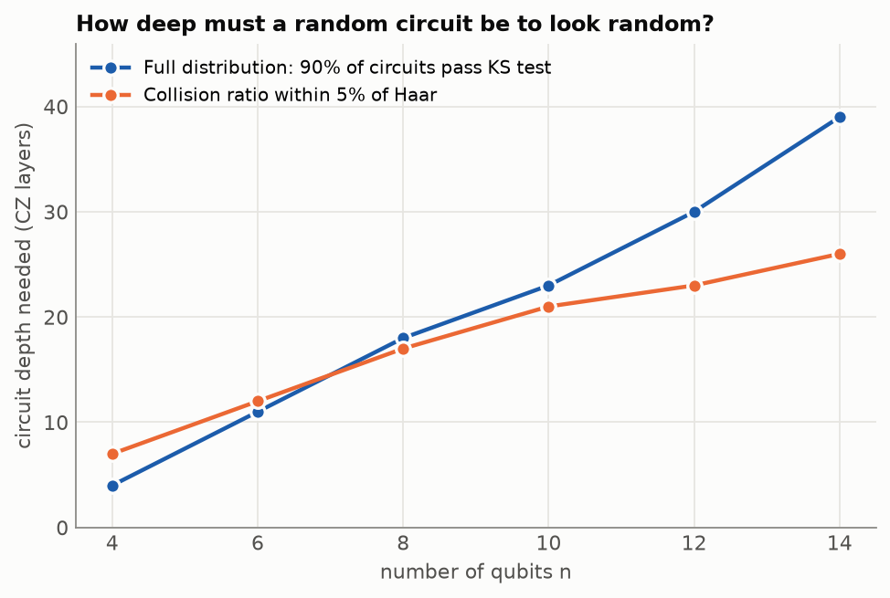
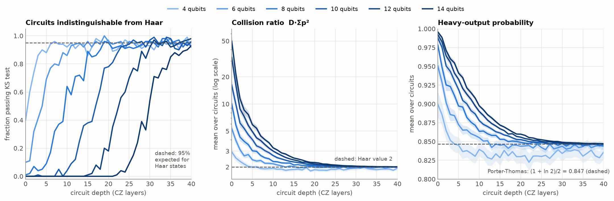
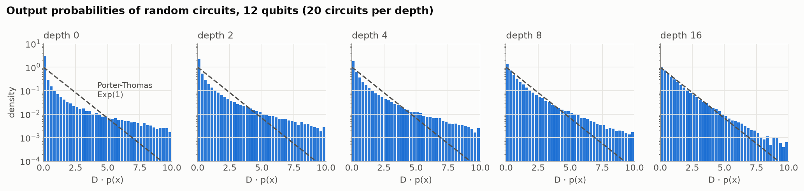

# Random quantum circuits and random matrix theory

How deep does a random quantum circuit have to be before its output actually looks random?

Random circuits are at the centre of how quantum hardware is benchmarked. Google's 2019 quantum advantage experiment and IBM's Quantum Volume test both rely on the same prediction from random matrix theory: for a truly random state on n qubits, the output probabilities scaled by D = 2^n follow an exponential distribution, known as Porter-Thomas. This project measures, by exact simulation in Qiskit, how many circuit layers it takes to reach that regime, and how the answer depends on what you mean by "random enough".

**Status:** Stage 1 is done. Stages 2 and 3 are in progress (see Roadmap).

## Setup

Circuits are 1D "brickwork" circuits. Each layer applies a Haar-random single-qubit gate to every qubit, then CZ gates on alternating pairs of neighbours. Depth counts the CZ layers; depth 0 is a random product state.

For each n in {4, 6, 8, 10, 12, 14} and each depth from 0 to 40, I simulated 100 random circuits exactly (statevector), about 25,000 circuits in total, and computed three statistics of each output distribution:

| Statistic | Haar-random value | What it measures |
|---|---|---|
| KS distance of D·p to Exp(1) | see below | full shape of the distribution |
| Collision ratio D·Σp² | 2D/(D+1), about 2 | how unevenly probability is spread |
| Heavy-output probability | (1 + ln 2)/2 = 0.847 | the quantity IBM's Quantum Volume test uses |

**Why not just use the KS test's p-value?** The D probabilities are not independent samples: they must sum to 1. So the textbook KS p-value does not apply. Instead I generated 2,000 genuinely Haar-random states for each n and used the 95th percentile of their KS distances as the cutoff. A circuit "passes" if it falls below that cutoff, so once circuits are indistinguishable from Haar states, about 95% should pass. I call a size converged at the first depth where at least 90% of circuits pass.

## Results



| Qubits | Depth for full distribution match | Depth for collision ratio within 5% of Haar |
|---|---|---|
| 4 | 4 | 7 |
| 6 | 11 | 12 |
| 8 | 18 | 17 |
| 10 | 23 | 21 |
| 12 | 30 | 23 |
| 14 | 39 | 26 |

1. **"Random" depends on how closely you look.** The collision ratio gets within 5% of its Haar value fairly quickly, and the depth needed grows slowly with n. Matching the full distribution takes much longer: the depth needed grows by about 3.4 layers per qubit (linear fit 3.39n − 9.64).
2. **The reason is resolution.** The KS cutoff from the Haar null halves every time two qubits are added (0.259 at n = 4, 0.0084 at n = 14), roughly as 1/√D. Larger systems have to be more precisely random to pass, and closing an exponentially small gap takes depth proportional to n.
3. **Theory values are large-D limits.** At n = 4 the heavy-output probability settles at about 0.83, not 0.847. Genuine 4-qubit Haar states give 0.831 too, so this is a finite-size effect rather than a failure to converge.





### Caveats

- The convergence depth is a noisy estimate. In an earlier run with a different random stream, n = 6 converged at depth 8 instead of 11. A bootstrap over circuits is the next fix.
- These are ideal, noiseless simulations. Real hardware adds noise, which is Stage 3.
- The 90% pass level and 5% collision tolerance are choices, not derived thresholds.

## Roadmap

- [x] **Stage 1:** Porter-Thomas convergence of random circuits.
- [ ] **Stage 2:** Eigenvalue spacing of the circuit unitaries compared with random matrix theory (Poisson to CUE transition).
- [ ] **Stage 3:** Noisy simulation with Qiskit Aer: cross-entropy fidelity and heavy-output probability, and the error rate at which circuits fail IBM's 2/3 Quantum Volume threshold.
- [ ] **Extension:** Random Clifford circuits, which are "random" in some senses but never reach Porter-Thomas.

## Run it

```
python -m venv .venv
.venv\Scripts\activate          # Windows; on Mac/Linux: source .venv/bin/activate
pip install -r requirements.txt
python -m pytest tests          # sanity checks
python run_porter_thomas.py     # full Stage 1 run, about 7-10 minutes
python run_porter_thomas.py --plot-only   # redraw figures from saved results
```

The random seed is fixed, so a full run reproduces the numbers above.

## Files

```
src/circuits.py          random brickwork circuit generator
src/stats.py             KS distance, collision ratio, heavy-output probability, Haar null
src/plotstyle.py         figure style
run_porter_thomas.py     Stage 1 experiment
tests/test_basics.py     checks that gates are Haar-random and statistics match theory
results/                 per-circuit and summary CSVs, thresholds, convergence depths
figures/                 plots above
```
